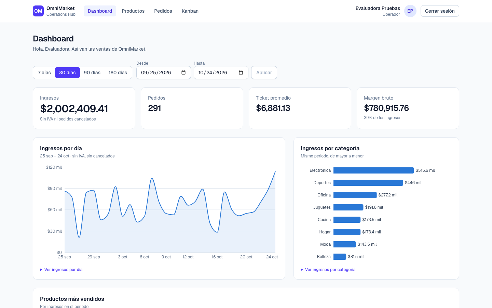
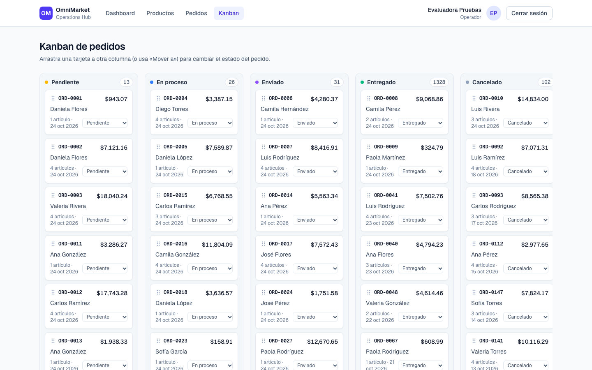
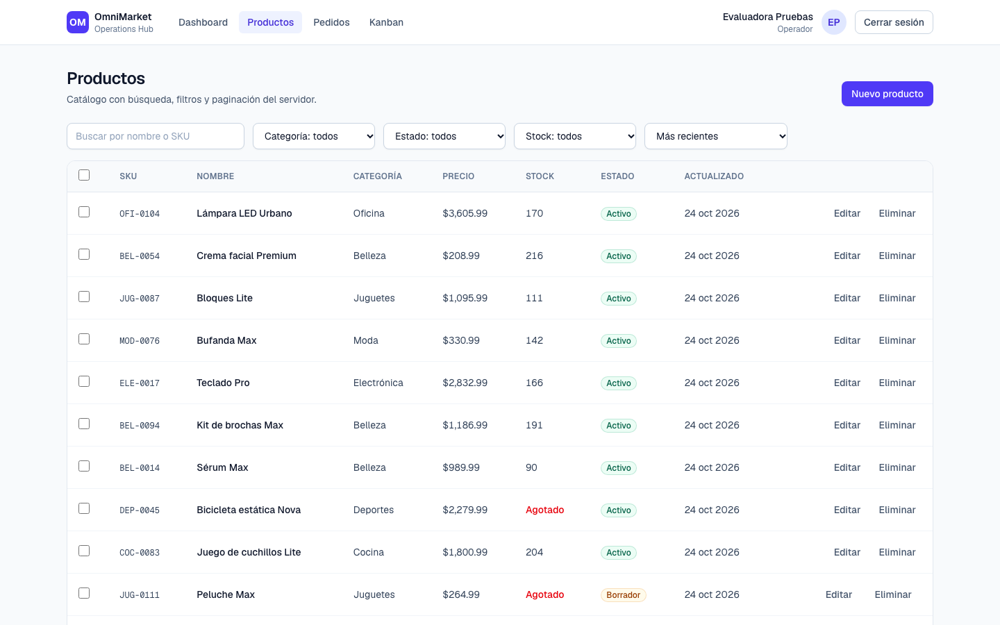
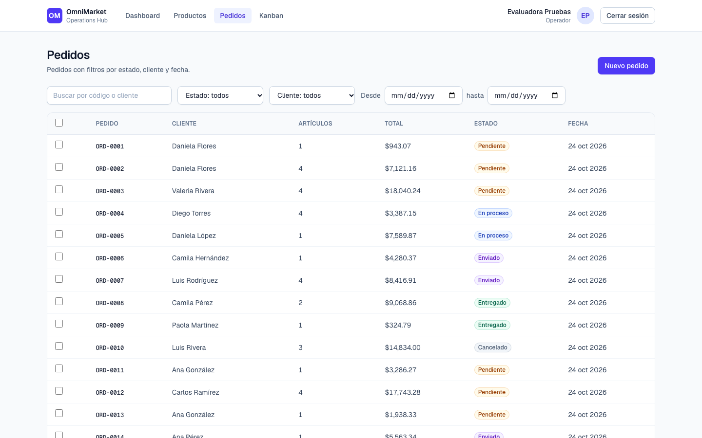

# OmniMarket · Operations Hub

[](https://github.com/Iza-9921/OmniMarket/actions/workflows/ci.yml)

Dashboard de analítica y administración de e-commerce: ventas, productos, pedidos y un tablero Kanban operativo. Hecho con Next.js 16 (App Router), TypeScript, Tailwind CSS y PostgreSQL.

**Producción:** <https://omnimarket-psi.vercel.app> · estado del servicio: <https://omnimarket-psi.vercel.app/api/health>



## Contenido

- [Guía para el evaluador](#guía-para-el-evaluador) (lista de comprobación §6)
- [Qué incluye](#qué-incluye)
- [Endpoints de auditoría](#endpoints-de-auditoría)
- [Pruebas](#pruebas)
- [CI/CD](#cicd)
- [Desarrollo local](#desarrollo-local)
- [Arquitectura](#arquitectura)

## Guía para el evaluador

Sigue la lista de comprobación de la sección 6 de la especificación. Cada paso dice qué hacer y qué debes ver.

### 1. URL pública y autenticación OAuth

1. Abre <https://omnimarket-psi.vercel.app>. El candado del navegador muestra un certificado válido (HTTPS).
2. Sin sesión, la app te lleva a `/login`. Prueba también abrir directamente <https://omnimarket-psi.vercel.app/kanban>: también redirige a `/login`.
3. Entra con **Google** o con **GitHub**. No existe usuario y contraseña.
4. Llegas al dashboard con tu nombre y tu foto arriba a la derecha. **Cerrar sesión** vuelve a proteger las rutas.

Toda cuenta nueva recibe el rol **Operador**, que puede usar todas las pantallas. Nadie es administrador por defecto.

### 2. Latencia de `GET /api/test/analytics`

```bash
curl -s -o /dev/null -w "HTTP %{http_code} en %{time_total}s\n" \
  "https://omnimarket-psi.vercel.app/api/test/analytics?page=1&limit=50"
```

- Responde `200` con `summary`, `data` (hasta 50 días) y `pagination`.
- El tiempo de las consultas en el servidor viene en la cabecera `Server-Timing` y en `meta.durationMs`. Medido en producción: **p95 de 5–13 ms** en 50 peticiones seguidas.
- El tiempo total que ve `curl` suma la red de quien mide. Desde Cuernavaca (Telmex) fue p50 172 ms y p95 278 ms.
- Para medir 50 peticiones seguidas con percentiles: `node scripts/latency.mjs https://omnimarket-psi.vercel.app 50`.

> **Primera petición en frío.** En el plan gratis de Neon la base de datos se suspende tras 5 minutos sin uso, y la primera consulta después tarda ~700 ms. Durante la semana de evaluación (hasta el 31 de octubre de 2026) un flujo de GitHub Actions ([`keep-warm.yml`](.github/workflows/keep-warm.yml)) la mantiene despierta.

### 3. Arrastre en el Kanban y persistencia

1. Abre **Kanban**. Hay una columna por estado: Pendiente, En proceso, Enviado, Entregado y Cancelado.
2. Arrastra la tarjeta **ORD-0001** de _Pendiente_ a _En proceso_. Se mueve al instante y aparece un toast de confirmación.
3. Recarga la página: la tarjeta sigue en _En proceso_.
4. Consulta el estado por API:

   ```bash
   curl "https://omnimarket-psi.vercel.app/api/test/kanban-status?orderId=ORD-0001"
   ```

   Devuelve `"status": "PROCESSING"` y el último movimiento (de dónde a dónde, cuándo y desde dónde: `KANBAN`).

Si el servidor rechaza el cambio, la tarjeta vuelve a su columna original y aparece un toast de error. Con el teclado: enfoca el asa ⠿ de la tarjeta y usa Espacio y las flechas, o el selector **Mover a** de cada tarjeta.



### 4. Pipeline de integración continua

En [GitHub Actions](https://github.com/Iza-9921/OmniMarket/actions/workflows/ci.yml) el último run de `main` está en verde. El despliegue a Vercel es el último job y **solo corre si pasan las pruebas** (ver [CI/CD](#cicd)).

### Reiniciar los datos

Para volver al conjunto de prueba inicial (por ejemplo, después de mover tarjetas):

```bash
curl -X POST -H "x-test-token: <token>" https://omnimarket-psi.vercel.app/api/test/reset-data
```

El token no se publica en este repositorio: viene en el documento de entrega del proyecto.

## Qué incluye

| Módulo                   | Qué hace                                                                                                                                                                                                                      |
| ------------------------ | ----------------------------------------------------------------------------------------------------------------------------------------------------------------------------------------------------------------------------- |
| **Autenticación**        | OAuth 2.0 con Google y GitHub (Auth.js v5). Rutas privadas protegidas en el proxy y otra vez en cada página y API. Sesión JWT de 8 horas en cookie `httpOnly`.                                                                |
| **Dashboard**            | KPIs de ingresos, pedidos, ticket promedio y margen bruto; ingresos por día y por categoría; productos más vendidos; periodos de 7, 30, 90 y 180 días o rango personalizado. Usa el mismo servicio que `/api/test/analytics`. |
| **Productos y pedidos**  | CRUD completo con paginación del servidor, búsqueda, filtros y orden en la URL, validación con Zod (mismos esquemas en cliente y servidor) y confirmación antes de eliminar. El total de un pedido lo calcula el servidor.    |
| **Kanban**               | Arrastrar y soltar con dnd-kit, actualización optimista, reversión ante error, toasts e historial de cada cambio de estado.                                                                                                   |
| **Edición en lote**      | Selección de filas en productos (precio en %, stock, estado, categoría) y en pedidos (estado). Todo o nada: si un registro falla, no cambia ninguno y la tabla vuelve a su valor anterior.                                    |
| **Experiencia de carga** | Skeletons en cada consulta y mutación (no hay spinners) y toasts de éxito o error.                                                                                                                                            |
| **Calidad**              | Sin errores de consola, WCAG 2.1 AA revisado con axe en todas las pantallas, páginas de error propias y diseño adaptable a celular.                                                                                           |

<p>
  
  
</p>

## Endpoints de auditoría

| Endpoint                                       | Acceso                  | Qué hace                                                                                                   |
| ---------------------------------------------- | ----------------------- | ---------------------------------------------------------------------------------------------------------- |
| `GET /api/test/analytics?page=1&limit=50`      | Público, solo lectura   | Métricas de ventas: resumen del periodo y detalle diario paginado. Opcional: `from` y `to` (`YYYY-MM-DD`). |
| `GET /api/test/kanban-status?orderId=ORD-0001` | Público, solo lectura   | Estado actual y último movimiento de un pedido. Sin `orderId`: número de pedidos por columna.              |
| `POST /api/test/reset-data`                    | Cabecera `x-test-token` | Restablece la base de datos al conjunto de prueba `omnimarket-v1`.                                         |

```bash
curl "https://omnimarket-psi.vercel.app/api/test/analytics?page=1&limit=50"
curl "https://omnimarket-psi.vercel.app/api/test/kanban-status?orderId=ORD-0001"
curl -X POST -H "x-test-token: <token>" https://omnimarket-psi.vercel.app/api/test/reset-data
```

- Las respuestas incluyen la cabecera `Server-Timing` y `meta.durationMs` con el tiempo de las consultas en el servidor.
- `limit` admite de 1 a 100. Los parámetros inválidos responden `400` con el detalle del error.
- Importes en MXN. **Ingresos** = subtotales sin IVA de pedidos no cancelados; **ticket promedio** = ingresos / pedidos; **margen bruto** = ingresos − costo.

### Conjunto de prueba `omnimarket-v1`

Determinista: 8 categorías, 120 productos, 60 clientes y 1 500 pedidos repartidos en los 180 días anteriores al reset. Los importes, códigos y estados son siempre los mismos; solo las fechas se recalculan respecto al día del reset. Los pedidos ancla `ORD-0001`…`ORD-0010` tienen estado fijo: 3 pendientes, 2 en proceso, 2 enviados, 2 entregados y 1 cancelado.

## Pruebas

| Tipo                              | Cantidad | Qué cubre                                                                                                                                                                                                     |
| --------------------------------- | -------- | ------------------------------------------------------------------------------------------------------------------------------------------------------------------------------------------------------------- |
| Unitarias (Vitest)                | 86       | Cálculos financieros (ticket promedio, márgenes), formato de moneda y fechas, esquemas Zod, lógica de filtrado y paginación, reglas de acceso, Kanban y lotes.                                                |
| Integración (Vitest + PostgreSQL) | 45       | Servicios y endpoints contra una base de datos real: catálogo, pedidos, Kanban, lotes, dashboard, reset y endpoints de auditoría.                                                                             |
| E2E (Playwright)                  | 47       | **Autenticación** (redirección y sesión simulada), **creación** de producto y pedido reflejada en la tabla, **Drag & Drop** con cambio de columna y persistencia, edición en lote, dashboard y accesibilidad. |

Toda prueba E2E falla si el navegador registra un error de consola. La sesión se simula firmando un JWT con el mismo `AUTH_SECRET` del servidor, porque automatizar el login real de Google o GitHub no es viable (captcha, 2FA).

## CI/CD

El pipeline está en [`.github/workflows/ci.yml`](.github/workflows/ci.yml):

1. **quality**: lint, typecheck, formato y pruebas unitarias.
2. **integration**: pruebas de integración contra un PostgreSQL efímero.
3. **e2e**: migraciones, seed, build de producción y pruebas E2E con Playwright.
4. **deploy**: solo en `push` a `main` y solo si los tres jobs anteriores pasan. Vercel compila el proyecto, aplica las migraciones antes del build (`vercel.json`) y el job comprueba `/api/health` y `/api/test/analytics`.

El despliegue automático de Vercel desde Git está desactivado en [`vercel.json`](vercel.json), así que **un test fallido impide desplegar a producción**.

### Secretos y variables

GitHub (_Settings → Secrets and variables → Actions_): `VERCEL_TOKEN`, `VERCEL_ORG_ID` (Team ID) y `VERCEL_PROJECT_ID`.

Vercel (_Project → Settings → Environment Variables_): `DATABASE_URL` y `DATABASE_URL_UNPOOLED` (integración de Neon), `TEST_ENDPOINTS_TOKEN`, `AUTH_SECRET`, `AUTH_GOOGLE_ID`, `AUTH_GOOGLE_SECRET`, `AUTH_GITHUB_ID` y `AUTH_GITHUB_SECRET`.

## Desarrollo local

Requisitos: Node.js 24.x, npm 11+ y PostgreSQL 17 (en macOS: `brew install postgresql@17 && brew services start postgresql@17`).

```bash
npm install
createdb omnimarket_dev && createdb omnimarket_test
cp .env.example .env.local   # y rellena las variables
npm run db:migrate
npm run db:seed
npm run dev
```

La aplicación queda en <http://localhost:3000>.

| Comando                    | Qué hace                                                            |
| -------------------------- | ------------------------------------------------------------------- |
| `npm run dev`              | Servidor de desarrollo                                              |
| `npm run build`            | Build de producción                                                 |
| `npm run start`            | Sirve el build de producción                                        |
| `npm run lint`             | ESLint                                                              |
| `npm run typecheck`        | Genera los tipos de rutas y ejecuta `tsc --noEmit`                  |
| `npm run format:check`     | Comprueba el formato con Prettier (`npm run format` lo corrige)     |
| `npm run test`             | Pruebas unitarias                                                   |
| `npm run test:integration` | Pruebas de integración contra PostgreSQL (`omnimarket_test`)        |
| `npm run test:e2e`         | Pruebas E2E. Requiere `npm run build` antes                         |
| `npm run db:generate`      | Genera una migración SQL a partir de `src/server/db/schema.ts`      |
| `npm run db:migrate`       | Aplica las migraciones pendientes                                   |
| `npm run db:seed`          | Carga el conjunto de prueba (borra los datos de negocio existentes) |

La primera vez hay que instalar el navegador de Playwright con `npx playwright install chromium`.

Contra un despliegue ya publicado:

```bash
PLAYWRIGHT_BASE_URL=https://omnimarket-psi.vercel.app AUTH_SECRET=<secreto> TEST_ENDPOINTS_TOKEN=<token> npm run test:e2e
AUTH_SECRET=<secreto> node --import tsx scripts/audit.mts https://omnimarket-psi.vercel.app   # consola y skeletons con red 3G
node scripts/latency.mjs https://omnimarket-psi.vercel.app 50                               # latencia p50/p95
```

## Arquitectura

```
src/app/(app)/**     Pantallas privadas (dashboard, productos, pedidos, Kanban)
src/app/api/**       Route Handlers: validación con Zod y respuestas HTTP
src/server/services  Lógica de negocio y consultas (la comparten páginas, API y endpoints de prueba)
src/server/db        Esquema Drizzle, cliente PostgreSQL y generador del seed
src/lib              Funciones puras compartidas: métricas, formatos, esquemas Zod, filtros
src/components       Interfaz (TanStack Query, TanStack Table, dnd-kit, Recharts)
drizzle/             Migraciones SQL versionadas
e2e/  tests/         Pruebas E2E, unitarias y de integración
```

| Tecnología                           | Uso                                                               |
| ------------------------------------ | ----------------------------------------------------------------- |
| Next.js 16 (App Router) + React 19   | Interfaz y API                                                    |
| TypeScript (strict) + Tailwind CSS 4 | Lenguaje y estilos                                                |
| PostgreSQL (Neon) + Drizzle ORM      | Base de datos. El dinero se guarda en centavos enteros            |
| Auth.js v5                           | OAuth con Google y GitHub                                         |
| TanStack Query / Table               | Datos del servidor, actualizaciones optimistas y tablas paginadas |
| dnd-kit                              | Drag & Drop accesible (ratón, toque y teclado)                    |
| Zod 4                                | Validación compartida entre cliente y servidor                    |
| Vitest + Playwright + axe-core       | Pruebas unitarias, de integración, E2E y de accesibilidad         |

El plan completo, con la matriz de cumplimiento de cada requisito, está en [`docs/PROJECT_PLAN.md`](docs/PROJECT_PLAN.md).
